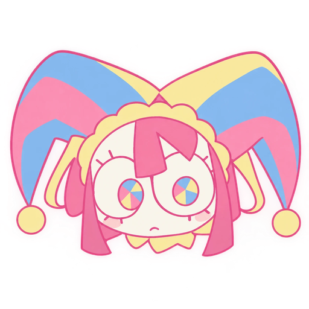

  ## 

  
  
  
  

  
  
  
    

  Nightly build from latest master. You can also browse all files under [Releases](https://github.com/novembahh/puppytunnelrblx/releases).
    

##

### 
PuppyTunnel

Host and join Roblox Studio sessions through a tunnel or private relay.
A better & open-source alternative to neptunnel!
